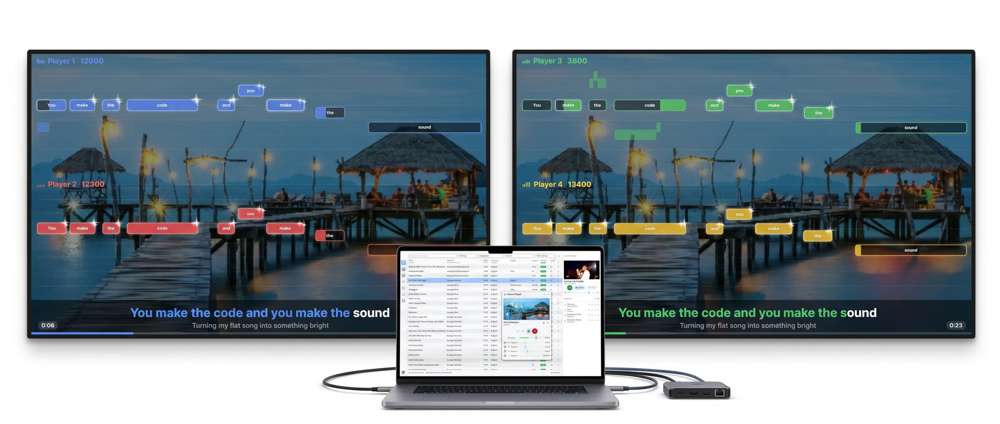

<p align="center">
  
</p>

<h1 align="center">Ultrastar DJ</h1>

<p align="center"><b>You run the party. They sing.</b><br>
A karaoke DJ booth on your laptop — free for Mac, Windows and Linux.</p>

<p align="center">
  <a href="https://retotito.github.io/Ultrastar-DJ/"><b>Website</b></a> ·
  <a href="https://retotito.github.io/Ultrastar-DJ/#download"><b>Download</b></a> ·
  <a href="https://github.com/retotito/Ultrastar-DJ/issues/new/choose">Report a problem or idea</a>
</p>

<p align="center">
  <a href="https://github.com/retotito/Ultrastar-DJ/releases"></a>
  <a href="https://github.com/retotito/Ultrastar-DJ/actions/workflows/ci.yml"></a>
  <a href="LICENSE"></a>
</p>

---

## What it does

You pick and line up the songs on your laptop; the singers see their notes and lyrics on TVs or projectors and score
points for every note they hit.

- **Up to four singers on up to two screens** — each with their own colour, notes and score. Only one screen? The game
  plays right in the DJ window.
- **Preview on headphones** — the preview player has its own audio output, so you can check the next song while the
  party sings.
- **Songbook for guests** — they scan a QR code on the screen, search your songs on their phones and send requests,
  which appear next to your queue. No app to install; works over Wi-Fi or mobile data, with an optional party PIN.
- **28,000 songs from [USDB](https://usdb.animux.de)** (free account) and your own UltraStar folders.
- **A .txt and a YouTube link is a song** — classic UltraStar songs with MP3 and video files work too.
- **Duet songs**, **microphone calibration** (fair scoring even over Bluetooth speakers), **light and dark mode**,
  keyboard shortcuts, 13 languages, and updates that install themselves.

More pictures and a setup guide: **[retotito.github.io/Ultrastar-DJ](https://retotito.github.io/Ultrastar-DJ/)**.

## Download

| Your computer | File |
|---|---|
| Mac with Apple Silicon (M1 or newer), macOS 14+ | `Ultrastar-DJ-…-osx-arm64.dmg` |
| Mac with Intel, macOS 14+ | `Ultrastar-DJ-…-osx-x64.dmg` |
| Windows 10 / 11 | `UltrastarDJ-win-Setup.exe` |
| Linux x64 | `UltrastarDJ.AppImage` (needs `libmpv2`, on older systems `libmpv1`) |

All files are on the [releases page](https://github.com/retotito/Ultrastar-DJ/releases). The app is not signed by
Apple or Microsoft, so the first start needs one extra click — the
[website](https://retotito.github.io/Ultrastar-DJ/#download) and each release explain how.

Ultrastar DJ is in **beta**: it works, and it needs people using it at real parties. Tell us what breaks or what you
miss — [report a problem or suggest an idea](https://github.com/retotito/Ultrastar-DJ/issues/new/choose).

## For developers

**Stack:** C# / .NET 10 · Avalonia 12 · libmpv · PortAudio · SQLite · ASP.NET Core (guest songbook) · Velopack
(installers and updates).

```sh
# 1. Install the .NET 10 SDK (version pinned in global.json)
# 2. Fetch the native parts for this machine (libmpv, yt-dlp, ffmpeg, cloudflared — never committed)
zsh scripts/fetch-natives.sh                                    # macOS
powershell -ExecutionPolicy Bypass -File scripts\fetch-natives.ps1   # Windows
bash scripts/fetch-natives-linux.sh                             # Linux (needs: sudo apt install libmpv2)
# 3. Build, test, run
dotnet build
dotnet test
dotnet run --project src/UltrastarDJ.App
```

| Doc | Content |
|---|---|
| [docs/00-vision.md](docs/00-vision.md) | What the app does, user flow, feature inventory |
| [docs/01-architecture.md](docs/01-architecture.md) | Projects, layers, dependency rule, runtime picture |
| [docs/02-media-engine.md](docs/02-media-engine.md) | libmpv, playback channels, clock and sync, device routing |
| [docs/03-game-engine.md](docs/03-game-engine.md) | UltraStar timing, mic pipeline, scoring, latency, beamer rendering |
| [docs/04-ui.md](docs/04-ui.md) | Windows, layout, MVVM rules, design tokens, keyboard shortcuts |
| [docs/05-conventions.md](docs/05-conventions.md) | Coding standards, threading, tests, definition of done |
| [docs/06-build-release.md](docs/06-build-release.md) | Native parts, packaging, releases, website, CI |
| [docs/07-roadmap.md](docs/07-roadmap.md) | Sprints — what is done and what is next |

AI coding agents: start with [.github/copilot-instructions.md](.github/copilot-instructions.md).

Every push runs the tests and GitHub's code security check; releases are built by GitHub Actions from a `v*` tag.

## Thanks

Songs from the [USDB](https://usdb.animux.de) community in the UltraStar format of
[UltraStar Deluxe](https://github.com/UltraStar-Deluxe/USDX). Built on [Avalonia](https://avaloniaui.net),
[mpv](https://mpv.io), [yt-dlp](https://github.com/yt-dlp/yt-dlp), [FFmpeg](https://ffmpeg.org),
[PortAudio](https://www.portaudio.com), [SQLite](https://sqlite.org), [Velopack](https://velopack.io) and
[cloudflared](https://github.com/cloudflare/cloudflared).

## License

[GPL-3.0](LICENSE) — free to use, change and share; what is built from it stays open source under the same license.
Found a security problem? Please report it privately: [SECURITY.md](SECURITY.md).
